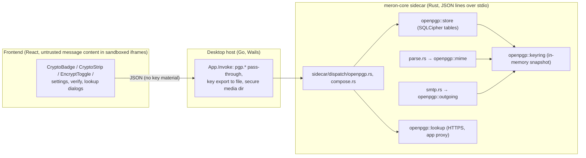
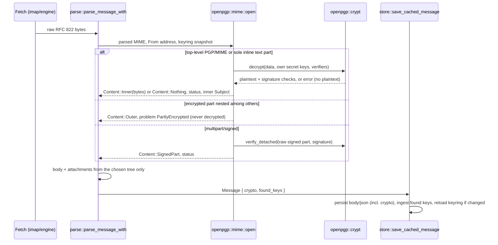
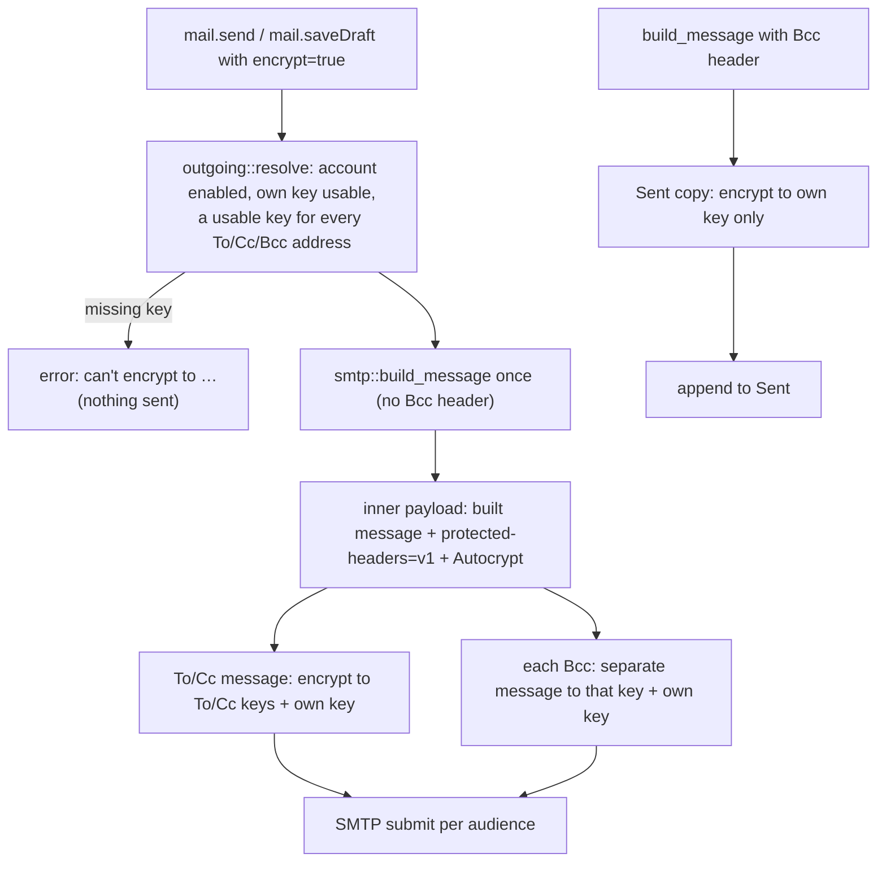

# OpenPGP end-to-end encryption: technical record

The design, crypto profile, storage, message flows, and the attack/control/test matrix for Meron's OpenPGP
end-to-end encryption (nonbili/meron#46). Every statement here names the code it describes; where the code and this
document disagree, the code is right and this document is the bug.

## Contents

1. [Scope and decisions](#1-scope-and-decisions)
2. [Architecture](#2-architecture)
3. [Dependencies](#3-dependencies)
4. [Cryptographic profile](#4-cryptographic-profile)
5. [Key storage](#5-key-storage)
6. [Key policy and trust](#6-key-policy-and-trust)
7. [Receiving](#7-receiving)
8. [Sending](#8-sending)
9. [Key distribution and discovery](#9-key-distribution-and-discovery)
10. [Bridge, desktop host and UI](#10-bridge-desktop-host-and-ui)
11. [Attacks and controls](#11-attacks-and-controls)
12. [Tests](#12-tests)
13. [Residual risks and limitations](#13-residual-risks-and-limitations)
14. [File map](#14-file-map)

## 1. Scope and decisions

Meron reads and writes OpenPGP mail (PGP/MIME, RFC 3156) in its Rust core, so desktop and mobile share one
implementation; this build wires up the desktop UI only. The maintainer asked for rPGP ("i'm inclined to rpgp, since
our imap/smtp libs are also used by delta chat", #46). Product decisions, with Delta Chat as the UX
model:

| Topic | Decision |
|---|---|
| Library | rPGP `pgp` 0.21.0, pinned exactly; our own policy layer on top |
| Enabling | Per account, never on by default. On enable: create a new key or import an existing one |
| Secret keys | Stored unprotected inside the SQLCipher database (no passphrase prompts); passphrase asked once at import |
| Decrypted mail | Stored like ordinary mail (SQLCipher body, full-text index, previews, notifications, MCP) |
| Correspondents' keys | Trust on first use (Autocrypt, attachments, lookup, import); explicit verification by fingerprint |
| When to encrypt | Composer lock; on by default when every recipient has a key (preference), sticky on replies to encrypted mail; off whenever a recipient lacks a key, except forwards of encrypted mail |
| Key lookup | Only on click; WKD and keys.openpgp.org by default, HKP keyservers addable |
| Indicator | Icon = encrypted (lock) or signed only (signature mark); colour = key trust; nothing on plain mail |

Research and the attack catalogue behind these choices: `notes/openpgp-security.md` (local, not in the repo).

<sub>[↑ Back to contents](#contents)</sub>

## 2. Architecture



- **Core modules** (`meron-core/src/openpgp/`): `keys` (generate, parse, unlock, policy), `crypt` (decrypt, verify,
  encrypt with limits), `mime` (PGP/MIME on receive, status), `outgoing` (PGP/MIME on send), `autocrypt`, `keyring`
  (shared snapshot), `store` (database), `lookup` (WKD/VKS/HKP).
- **Keyring snapshot:** `parse_message` runs inside fetch paths without a database handle, so all keys are loaded into
  a process-wide `RwLock<Arc<Keyring>>` (`keyring::current/replace`) by `store::init_main` in `Engine::new`, and
  reloaded after every key change. Tests pass their own `Keyring` (`parse::parse_message_with`).
- **Main-store guard:** the Local Folders archive engine saves messages through the same code. `store::init_main`
  records the main database path; `reload` and `ingest` do nothing for any other connection (`is_main`), so the archive
  can neither record keys into its unused tables nor replace the keyring with an empty one.

<sub>[↑ Back to contents](#contents)</sub>

## 3. Dependencies

`meron-core/Cargo.toml`:

| Crate | Version | Why |
|---|---|---|
| `pgp` (rPGP) | `=0.21.0`, `default-features = false` | All OpenPGP operations. Exact pin: only the latest release gets security fixes (rPGP SECURITY.md), so upgrades are deliberate. Default features off drops bzip2 (as Delta Chat does); bzip2-compressed messages are unreadable |
| `rand` | 0.8 | RNG for rPGP's APIs (`thread_rng`) |
| `zeroize` | 1 | Wipe passphrases and stored-key buffers after use |
| `smallvec` | 1 | rPGP's key-builder preference lists |

Features **not** enabled: `malformed-artifact-compat` (README: "should be disabled by default"), `pqc`, `large-rsa`,
`draft-wussler-openpgp-forwarding`. Existing dependencies reused: `ring` (SHA-1 for WKD hashing only), `ureq` +
`proxy::agent` (lookups), `url`, `base64`, `mailparse`, `mail-builder`, `rusqlite` (SQLCipher).

The lock file gains 87 crates, all pulled by rPGP (RustCrypto primitives and their helpers):
aead, aes-gcm, aes-kw, argon2, base16ct, base64ct, bitfields(-impl), bitvec, blake2, blowfish, buffer-redux,
camellia, cast5, cfb-mode, cmac, const-oid, convert_case, crc24, crypto-bigint, ctr, curve25519-dalek(-derive), cx448,
darling(_core, _macro), dbl, der, derive_builder(_core, _macro), des, dsa, eax, ecdsa, ed25519, ed25519-dalek,
elliptic-curve, ff, fiat-crypto, fnv, funty, ghash, group, idea, ident_case, k256, keccak, num-bigint-dig,
num_enum(_derive), ocb3, opaque-debug, p256, p384, p521, password-hash, pem-rfc7468, pgp, pkcs1, pkcs8, polyval,
primeorder, radium, replace_with, rfc6979, ripemd, rsa 0.9.10, sec1, serdect, sha1-checked, sha3, signature, snafu(-derive),
spin, spki, strsim, tap, twofish, unicode-segmentation, universal-hash, wyz, x25519-dalek, zlib-rs.
Legacy ciphers (IDEA, CAST5, Blowfish, 3DES, Twofish, Camellia) are compiled in by rPGP for reading old mail; Meron
never encrypts with them.

**Advisories** (`cargo audit` 0.22.2): the branch adds two, both inside rPGP's
dependencies and both without a fix it can take, ignored with their reasons in `meron-core/.cargo/audit.toml`:
RUSTSEC-2023-0071 (`rsa` 0.9.10, Marvin timing attack, no fixed release) and RUSTSEC-2026-0387 (`crypto-bigint` 0.5.5,
secret-dependent timing, fixed only in 0.7.6, which rPGP 0.21 doesn't use; it sits under the NIST P-256/384/521,
secp256k1 and X448 curves, while Meron's own keys use `curve25519-dalek`). With that file the branch reports exactly
upstream `main`'s advisories (17 at `901712bc`, none from this branch). Re-run on every rPGP upgrade.

<sub>[↑ Back to contents](#contents)</sub>

## 4. Cryptographic profile

**Generated keys** (`keys::generate`):
- v4, Ed25519 ("legacy" EdDSA) primary with certify + sign flags; one Cv25519 ECDH subkey for encryption
  (communications and storage). Same shape as Delta Chat's `create_keypair`.
- User IDs `<address>` for the account address and every alias at creation time; no expiry; no passphrase.
- Preferences: AES-256, AES-192, AES-128; SHA-256, SHA-384, SHA-512; ZLIB, ZIP.
- **SEIPDv2 is not advertised** (`feature_seipd_v2(false)`), unlike Delta Chat. GnuPG 2.4 can't read SEIPDv2; an
  interop test caught two Meron keys producing an unreadable message, and users may export their key to GnuPG,
  Thunderbird or OpenKeychain. Peers therefore send SEIPDv1 with MDC.
- After generation: `verify_bindings`, then the self-test (see §5).

**Encryption** (`crypt::encrypt`):
- Recipients: each key's encryption subkey chosen by `keys::encryption_subkey` (§6). Public-key-encrypted session
  key packets name the recipient key IDs (non-anonymous; anonymous key IDs break some clients). Bcc privacy is
  handled by separate messages (§8).
- SEIPDv2 (AES-256, OCB, 8 KiB chunks) only if **every** recipient key advertises it, else SEIPDv1 (AES-256) with MDC.
  With Meron's own keys in the audience this is always v1.
- Always signed by the account's default key, SHA-256, with hashed subpackets: signature creation time (critical),
  issuer fingerprint, and one **intended recipient fingerprint** per recipient key (RFC 9580 §5.2.3.36); unhashed
  issuer key ID.
- Compression: ZLIB inside the encryption.
- Output armored.

**Decryption** (`crypt::decrypt`):
- Input capped at `MAX_CIPHERTEXT_BYTES` = 50 MiB (`TooLarge`).
- Parsed armored or binary; anything that isn't an encrypted message is `Unreadable`.
- `decrypt_the_ring` with all own secret keys (current and replaced ones, all accounts), empty passwords, and rPGP's
  **default options**: SEIPDv1 in `CheckFirst` mode (the whole packet is decrypted and its MDC checked before any
  plaintext is released; rPGP buffers up to 1 GiB, which Meron's 50 MiB input cap bounds), legacy SED off, GnuPG's
  packet-20 AEAD off. The streaming mode is never used.
- Errors: `MissingKey` → `NoKey`; any other decryption error → `Integrity`.
- Decompression is lazy; the literal data is read through `take(MAX_PLAINTEXT_BYTES + 1)` with
  `MAX_PLAINTEXT_BYTES` = 64 MiB; more is `TooLarge`; any trailing byte after the cap check is also `TooLarge`. This is
  Meron's own cap for rPGP's unbounded decompression (GHSA-9rq6-pw5r-326p).
- The whole call runs under `catch_unwind`; a library panic becomes `Unreadable`.
- No plaintext is returned with any error (fail closed).

**Signature verification** (`crypt::check_message_signatures`, `crypt::verify_detached`):
- Candidate keys are filtered by the signature's issuer (fingerprint, or key ID as fingerprint suffix).
- Each candidate is tried with its primary key and every subkey that has a valid binding with the sign flag (rPGP's
  `VerifyingKey` for a certificate checks the primary only).
- A signature counts as valid only if it verifies, its hash is acceptable (`keys::data_hash_ok`: not MD5, SHA-1,
  RIPEMD-160 or unknown), **and the signing key was valid when the signature was made** (`SigningPart::valid_at` →
  `keys::primary_valid_at` / `keys::subkey_valid_at`, evaluated at the signature's creation time):
  - revoked: any verifying revocation voids the signature, except a revocation with reason *key superseded* or
    *key retired* (RFC 9580 §5.2.3.31), which voids only signatures made at or after the revocation time;
  - expired: the primary's expiry (newest self-signature) or the signing subkey's binding expiry had passed;
  - a signing subkey is also void if a verifying subkey revocation applies.
  Such signatures are reported with `key_problem` (`revoked` / `expired`) and never valid.
  Weak-hash signatures are reported `weak_hash` and never valid.
- Detached signatures (`multipart/signed`) are verified over the raw bytes of the signed MIME part as `mailparse`
  delivers them (`raw_bytes`), which is what RFC 3156 signs.

**Secret-key export** (`keys::export_protected`): passphrase required, rPGP `set_password` with the v4 default
(iterated-and-salted S2K, CFB), readable by GnuPG, Thunderbird and OpenKeychain. Minimum 8 characters enforced in the
UI only.

<sub>[↑ Back to contents](#contents)</sub>

## 5. Key storage

**Schema** (`openpgp::store::DDL`, applied by `store::db::migrate_v22`, `PRAGMA user_version` 21 → 22):

```sql
CREATE TABLE openpgp_accounts (account_id TEXT PRIMARY KEY, enabled INTEGER NOT NULL DEFAULT 0);
CREATE TABLE openpgp_own_keys (fingerprint TEXT PRIMARY KEY, account_id TEXT NOT NULL,
  secret_key BLOB NOT NULL, is_default INTEGER NOT NULL DEFAULT 1, added_at INTEGER NOT NULL);
CREATE INDEX openpgp_own_keys_account ON openpgp_own_keys(account_id);
CREATE TABLE openpgp_peer_keys (addr TEXT NOT NULL, fingerprint TEXT NOT NULL, public_key BLOB NOT NULL,
  source TEXT NOT NULL, verified INTEGER NOT NULL DEFAULT 0, first_seen INTEGER NOT NULL,
  last_seen INTEGER NOT NULL, PRIMARY KEY (addr, fingerprint));
CREATE TABLE openpgp_offer_dismissed (account_id TEXT NOT NULL, addr TEXT NOT NULL,
  PRIMARY KEY (account_id, addr));
CREATE TABLE openpgp_key_used (addr TEXT PRIMARY KEY, fingerprint TEXT NOT NULL, used_at INTEGER NOT NULL);
```

`openpgp_key_used` came after the migration; `store::init_main` runs the whole `DDL` (every statement
`IF NOT EXISTS`) on each start, which adds it to stores already past the OpenPGP migration. For the PR it folds into the
migration.

The archive database runs the same migrations, so these tables also exist (empty) in `archive.db`.

**Own secret keys:**
- Stored as binary OpenPGP, **without a passphrase**, in `openpgp_own_keys.secret_key`. Protection at rest is
  SQLCipher, whose raw key is held in the OS keyring (`secrets::db_key`, entry `__meron_db_key__`). Decision rationale:
  a second keyring-held wrapping key would only protect against someone holding the database key but not the keyring;
  both sit in the same keyring.
- Import (`keys::unlock`): the passphrase removes protection from the primary and every subkey (`remove_password`);
  failure returns `NeedsPassphrase` (no lockout, no counter). GnuPG stubs (secret part on a smartcard, or exported with
  `--export-secret-subkeys`) are detected as `OnCard` by recognising rPGP's private S2K type in the encrypted
  parameters (`keys::is_stub`, a string match on the debug representation; see §13).
- Every load runs `keys::self_test`: `verify_bindings`, then a SHA-256 detached signature over a random UUID with the
  primary secret key, verified with the public key. A key that fails to parse or self-test is skipped (left in the
  table, never used).
- Several keys per account; one `is_default` (signs, Autocrypt). Replaced keys stay for decryption.
- Buffers holding serialized secret keys are `zeroize::Zeroizing`; rPGP's own types handle the key material in memory.
  Secret keys never leave the core except as a passphrase-protected export.

**Peer keys:** binary public keys per (address, fingerprint), with source (`autocrypt`, `gossip`, `attachment`,
`imported`, `wkd`, `keyserver`), `verified`, `first_seen`, `last_seen`. Stored key bytes are **never replaced**,
only extended by `keys::merge` (see §6), so an older copy arriving late can't undo a revocation.

**Backups** (`backup.rs`, `openpgp::store::backup_collect/backup_apply`): an `openpgp_keys` section with, per account,
the enabled flag, armored public keys, and base64 secret keys **only when the backup includes secrets** (that path
requires a passphrase; PBKDF2-SHA256 600k + AES-256-GCM, unchanged). Restore keeps existing keys, makes a restored key
default only if the account had none, self-tests each key, and reports accounts whose secret keys were missing.
Peer keys and verification marks are not in backups.

<sub>[↑ Back to contents](#contents)</sub>

## 6. Key policy and trust

`keys::check(key, now)` → unusable when:
1. **Revoked:** a revocation signature on the primary that is genuine (`revocation_valid`): made by the key itself, or
   a key revocation (type 0x20) made by a **designated revoker** (RFC 4880 §5.2.3.15). Designated revokers are read
   only from the key's own valid self-signatures (`designated_revokers`: direct-key signatures and user-ID
   self-certifications, hashed area), so nobody else can add one. A third-party revocation counts only if the named
   revoker's public key is available (own or stored peer key, looked up by `Resolver`) and the revocation verifies
   against its primary key (`verify_key_third_party`); otherwise it doesn't count. Such a revocation is still stored
   when its issuer is a named revoker whose key Meron doesn't have yet (`pending_revocation`, at most
   `MAX_PENDING_REVOCATIONS` = 4 per key), so it counts once that key arrives; one by anyone the key doesn't name is
   dropped.
2. **Invalid bindings:** no user ID whose newest verifying self-certification passes the binding hash policy
   (`binding_hash_ok`: MD5/RIPEMD-160 never; SHA-1 only if the signature is older than `SHA1_BINDING_CUTOFF`
   = 2023-02-01, Sequoia's standard-policy cutoff).
3. **Expired:** the newest self-signature's key-expiration time has passed.
4. **No encryption key:** `encryption_subkey` finds none.

`keys::encryption_subkey`: subkeys with an encrypting algorithm, whose newest verifying binding is not a revocation,
passes the binding hash policy, carries an encrypt flag and isn't expired; of several, the one expiring soonest (Delta
Chat's and the Autocrypt v2 draft's rule).

**Trust levels** (`keyring::Trust`, computed at read time, never stored):
- `Verified`: signed by one of the user's own keys, or by a peer key the user marked verified.
- `Known`: signed by a stored peer key for the From address (TOFU).
- `Unconfirmed`: unsigned, signed by an unknown key, a problem, a partial or weak-hash signature.

**TOFU rules** (`store::ingest`):
- A key never seen for the address is added; a known one only moves `last_seen` forward (never back: old mail fetched
  late must not win). `last_seen` is the message's `Date:` clamped to now (Autocrypt's effective date): the header is the
  sender's claim, and one forged mail dated years ahead would otherwise stay the newest and choose the address's key
  for good (`a_future_date_header_cannot_pin_a_key_as_the_newest`).
- **Key changes before sending**: TOFU still switches to a newer key by itself, but the composer
  says so. After every encrypted send the core records, per correspondent address, the key it encrypted to
  (`store::record_used`, from `outgoing::chosen_peer_keys`; our own addresses don't count). `pgp.keys.forRecipients`
  reports `changed` (`store::key_changes`): recipients whose key now differs from the one last used. A first contact has
  nothing to compare and is not listed; once a send to the new key succeeds, it is the one compared against.
- Gossip (`Autocrypt-Gossip`) only fills addresses with no key at all.
- Keys with `check()` problems other than expiry are not ingested.
- `Keyring::encryption_key_for`: a verified usable key wins; if the verified key is unusable and only unverified ones
  remain, encryption is refused (`NewKeyUnverified`); otherwise the most recently seen usable key.

**Resolvers:** functions that need a revoker's key take a `Resolver` (fingerprint → public key): the store resolves
from its own database (`store::db_key`), the parser from the keyring snapshot it was given
(`Keyring::key_by_fingerprint`), and calls without context (`keys::check`, `merge`) from the global snapshot
(`keys::stored_key`).

**Updates to stored keys** (`keys::merge`, `store::merge_into_stored`): whenever a copy of a stored key arrives
(Autocrypt, gossip, attachment, keyring import, lookup), it is merged into the stored key for every address row:
revocation signatures, direct-key signatures, user-ID certifications and subkey bindings it adds, plus new user IDs
and subkeys. Only signatures that verify against the stored primary key are taken (nobody but the key's owner can
change it), except revocations, which may also come from a designated revoker (checked against the merged
self-signatures, so a designation and a revocation can arrive together; one by a named revoker whose key isn't known yet
is kept unverified, capped, and checked on every use); duplicates are skipped, and each component
keeps at most 64 signatures. This runs before the usability
check, so a **revoked copy is merged even though it would never be accepted as a new key**; the merged key then fails
`check()` (Revoked) and drops out of encryption, and its signatures stop counting (§4).

**Verification** (`store::set_verified`): the call carries the fingerprint the user confirmed (pasted, or the shown one
after ticking "I compared them"); the core normalises it and refuses unless it equals the stored key's fingerprint.
Verification is local and per key; not exported, not synced.

<sub>[↑ Back to contents](#contents)</sub>

## 7. Receiving



**Detection** (`mime::open`, `mime::encrypted_data`), on the **top-level** body only:
- RFC 3156: `multipart/encrypted` with exactly `application/pgp-encrypted` + `application/octet-stream`.
- Exchange shape: `multipart/mixed` [empty `text/plain`, `application/pgp-encrypted`, `application/octet-stream`].
- Google Workspace shape: `multipart/mixed` [empty `text/plain`, RFC 3156 part].
- Inline: a top-level `text/plain` (no subparts) whose body starts with `-----BEGIN PGP MESSAGE-----`. The plaintext is
  wrapped as `text/plain; charset=utf-8`; no protected headers are read from it.
- An encrypted part anywhere else → `PartlyEncrypted`, nothing decrypted, the message shown as received.
- `text/html` containing an armored block → `InlineInHtml` (neutral note), nothing decrypted.
- Signed: top-level `multipart/signed` [content, `application/pgp-signature`] → only the first part is shown. Mailing
  list shape: `multipart/mixed` whose first part is `multipart/signed` → `partial`; the whole message is shown (Meron's
  existing body selection takes the first text part).
- Cleartext signatures (`BEGIN PGP SIGNED MESSAGE`) are not recognised and show as plain text with no indicator.

**After decryption:**
- The inner bytes are parsed again. Protected headers: the inner top-level `Subject` replaces the outer one (RFC 9788
  / Memory Hole `protected-headers="v1"`; the inner `From` is not compared to the outer one).
- Autocrypt headers inside the encrypted part replace outer ones for the sender (Delta Chat's rule); keys from inner
  headers and attached keys are used to re-check signatures that didn't verify.
- Sign-then-encrypt as two layers (inner `multipart/signed`) is verified and its first part shown.

**Signature evaluation** (`mime::apply_signature`):
- No valid signature: if a signature names a key we hold (or verified against a key but failed policy) and it isn't
  weak-hash → `InvalidSignature`; on a mailing list (`List-Id`) that becomes `partial` instead (lists change messages).
  Otherwise unsigned/unknown, no problem.
- A signature that verified but whose key was revoked or expired at signing time → `KeyRevoked` / `KeyExpired`
  (danger), no signer, trust Unconfirmed. This check comes first.
- Valid signature: `signer` = primary fingerprint. If the signing key's user IDs don't include the From address and it
  isn't one of the user's keys → `SignerMismatch`.
- `key_changed`: valid signer not among the stored keys for the From address while other keys are stored, and not own.
- Verification uses `Keyring::verifiers_for(from)`: the From address's keys, then own keys, then every other stored
  key (so a signature by someone else's key is identified as a mismatch rather than "unknown"), plus keys announced in
  the message.

**What is shown and stored** (`parse::parse_message_with`):
- Body, HTML and attachments are extracted from the chosen tree only (`Content::Outer | SignedPart | Inner`); on
  `Content::Nothing` the message has no body, no HTML and no attachments.
- `Message.crypto: Option<CryptoStatus>` is persisted in `messages.json` with every field written (nulls included),
  because `json_patch` merges and a missing field would keep stale values.
- Decrypted plaintext goes into `messages.body` (full-text index, previews, notifications, MCP), by decision (§1).
- Decrypted attachments are written under `parse::secure_media_root()` (`MERON_SECURE_MEDIA_DIR`, set by the desktop to
  `$XDG_RUNTIME_DIR/<app>/secure-media`, a per-user tmpfs, and without `XDG_RUNTIME_DIR` (macOS, Windows, Linux
  without a logind session) to `<per-user cache>/<app>/secure-media`: a fixed path no other local user can write, not
  the shared temp dir; mode 0700) and keyed `e2ee/…`; `parse::media_file` resolves the prefix. **The desktop empties
  that dir at start (before the sidecar, `prepareSecureMedia`, which recreates it 0700) and at quit (after it), on
  every platform** (`wipeSecureMedia`): decrypted files exist only while Meron runs. Because the path is the same in
  every run, the wipe at start also clears what a crashed or killed run left. A missing
  file is reported by `missing_media_count`, and the message is fetched and decrypted again. The OS cleanup can't be
  relied on instead: macOS removes `$TMPDIR` files only after 3 days without access ("may be cleaned", not API),
  Windows only through Storage Sense if enabled. After a crash or kill the files stay until the next start.
- Opening a decrypted attachment in another app copies it into `secure-media/attachment-open/` (`attachmentOpenRoot`),
  not `<cache>/attachment-open` like plain ones, so the wipe covers it. On Windows a copy another app still holds open
  can't be deleted at quit; the next start removes it.
- A verified `signature.asc` (`application/pgp-signature`) is dropped from the attachment list.
- Attached key files (`application/pgp-keys`) that hold only the sender's own keys (`mime::sender_key_files`; what
  Thunderbird attaches to every signed message) are dropped from the attachment list; the keys are recorded (§9). Key
  files with anyone else's key stay visible. A one-time cleanup in `store::init_main`
  (`reparse_key_attachments_once`, marker setting `openpgp_reparse_key_attachments`) drops the cached bodies of
  messages that list such a file, so they are fetched and parsed again.
- Header sync (`store::upsert_messages`) keeps the stored subject for rows whose `$.crypto.encrypted` is true and whose
  body exists, so the outer placeholder (`[...]`) never overwrites the decrypted subject.
- **Bodies cached by a build without OpenPGP** (no `$.crypto`, plus an `encrypted.asc` / `application/pgp-encrypted`
  file, an inline `-----BEGIN PGP MESSAGE-----` body or a placeholder subject) would never be fetched again, so stayed
  undecrypted however often opened. A one-time cleanup in `store::init_main`
  (`refetch_encrypted_cached_without_openpgp_once`, marker `openpgp_refetch_encrypted_cached_without_openpgp`) drops
  them so the next read or prefetch decrypts them (`f0e428c7`).
- **Prefetch** (`engine::prefetch`) adds rows still titled `...` / `[...]` without a cached body to its 14-day window,
  whatever their age (`store::undecrypted_placeholder_uids`, `aa83ffdd`), so old encrypted mail gets its real subject
  without being opened.
- **Two-layer sign-then-encrypt** (older Enigmail, K-9): the protected Subject, From and Autocrypt headers sit on the
  signed part, one level below the decrypted top; `mime::open_encrypted` reads them only there when `signed_inside`,
  never from the `multipart/signed` wrapper, which the signature doesn't cover (fixture `enc-two-layer.eml`).
- **Keys a payload carries** (protected `Autocrypt:` headers, attached `application/pgp-keys`) are dropped when the
  message is `Redirected`, `SignerMismatch` or `InvalidSignature`: a lifted or mis-signed payload can't hand in keys.
- **Thread titles**: a card is titled by its thread's oldest message (`store::pick_root`). When that is an encrypted
  message not yet decrypted, `threads::thread_title` takes the oldest message that knows its subject instead; with none,
  the placeholder stays (chosen over an "Encrypted message" label). Display only; grouping is unchanged
  (`4ebda5c1`).
- **Replies titled with the placeholder**: a client that had not decrypted a thread writes `Re: [...]` as its reply's
  protected subject. That groups as an empty subject (`thread_grouping_subject` strips the bracket tag) and forms a
  subject branch of its own, so the chat view loses the reply. `store::repair_placeholder_reply_subjects` gives
  encrypted rows whose subject is only the placeholder `Re: <subject>` from the oldest message in their thread that has
  one: in `save_cached_message` for every encrypted body (either save order), and over all accounts on every start
  (`repair_placeholder_reply_subjects_everywhere`, from `openpgp::store::init_main`). Plain mail is never changed
  (`87b31a69`).
- **Gmail threading**: Meron normally takes Gmail's conversation id (`X-GM-THRID`) as the thread key, and Gmail groups
  by subject similarity. For encrypted mail Gmail only sees the placeholder, the same for every encrypted message, so
  it merged unrelated conversations between the same people, even a new message. `imap::thread_key` ignores Gmail's
  id when the subject is only the placeholder (`is_encrypted_placeholder_subject`; an empty plain subject keeps
  Gmail's id) and threads by References / In-Reply-To / Message-ID; `resolve_message_thread_key` still joins the thread
  a referenced message is cached under, Gmail's id included. Rows synced before this keep their merged key until
  re-synced. Gmail's own web UI stays merged (encrypted-mail users won't use Gmail's UI).
- **Plain replies in an encrypted Gmail thread**: with encryption turned off, a reply has a real subject (`Re: …`),
  so Gmail files it in a conversation of its own and it got a new `gmthrid:` key; on the Mac the thread split in two
  (Linux, no `X-GM-THRID`, stayed whole). `store::encrypted_gmail_thread_of` finds the message a reply answers
  (In-Reply-To) when that is a Gmail row (it has `gmail_msg_id`) keyed by headers, which only encrypted mail is;
  `upsert_messages` gives a `gmthrid:` reply that key, and `reconcile_thread_keys_from` does the same for replies
  that synced first. Rows without a Gmail id (cached from our own bytes, keyed by Message-ID for any mail) don't
  count, so plain Gmail conversations keep Gmail's threading. Existing splits are not repaired (not public, a
  fresh thread will do).
- **Branches and messages not yet decrypted**: Message-ID-keyed threads split into subject branches. A message not yet
  decrypted shows only the placeholder, which groups as no subject, so branch filters dropped it; on Gmail, where our
  Sent copies are filed by Gmail (not appended and cached by us) and stay undecrypted until fetched, the Mac's chat
  lost every message it had sent. `store::subject_in_branch` keeps such messages in every branch of their thread (thread
  view, thread actions, newest-message lookups), and `group_thread_cards` puts them in the branch of the thread's title,
  which also decides `original_thread_key`. One shared `store::is_encrypted_placeholder_subject` serves this and the
  Gmail threading rule.
- Remote content: `engine::read::attach_html` forces `allowed = false` for encrypted messages (the CSP built by
  `prepare_message_html` then blocks all remote loads); the frontend never offers a reveal for them.
- After importing an own key, rows with problem `no_key` lose their body and crypto status
  (`forget_undecryptable`), so the next read fetches and decrypts them.

**Frontend view** (`mime::view_json`, added to each message by `thread_read::thread_message_json`): `encrypted`,
`signed`, `trust`, `signer`, `issuer`, `partial`, `weak_hash`, `problem`, `key_changed`, `verified_conflict` (new key
while a verified one exists), `on_list`, `own`, `signer_stored`, `offer`. Thread cards get `encrypted`: the trust of an
encrypted newest message, or null (`store::card_lock`).

<sub>[↑ Back to contents](#contents)</sub>

## 8. Sending



- **Enforcement in the core:** `sidecar/dispatch/compose.rs` reads `encrypt`; with it set, `outgoing::resolve` must find
  a key for every recipient or the send fails with "can't encrypt to …". There is no code path that sends an
  `encrypt: true` message in the clear. Keys come from `Keyring::encryption_key_for`, or the user's own key for their
  own addresses.
- **Replies to encrypted mail**: the core doesn't rely on the caller's flag alone. `store::reply_protection`
  looks up the message named in In-Reply-To (`store::answers_encrypted`: a cached message of the account with
  `$.crypto.encrypted`) and applies `outgoing::protection`: encrypted when `encrypt` is set, or when the reply answers
  encrypted mail and the caller didn't send `plain: true`. Such an implicit send needs keys for every recipient like any
  encrypted one (refused naming them, "this replies to encrypted mail, so it can only be sent encrypted"); an implicit
  draft is encrypted to the account's own key, even with encryption turned off for the account. The editor sends
  `plain` only when its `encrypt` is `false` (never for a missing flag, so a path that loses `encrypt` can't downgrade a
  thread); the quick reply always decides and sends `plain: !encrypt`. MCP `send_message`, `create_draft` and
  `update_draft` send neither, so replies into encrypted threads come out encrypted, and the approval preview says so
  (`pgp.reply.encrypted`, `mcp.sendsEncrypted`).
- **Payload** (`outgoing::inner_payload`): the complete message as built by `smtp::build_message` (all headers,
  including From, To, Cc, Subject, Date, Message-ID, In-Reply-To, References), with `; protected-headers="v1"`
  appended to its Content-Type and our `Autocrypt:` header prepended. Delta Chat checks a signature only against the key
  announced in the same message, so the header must be inside.
- **Outer message** (`outgoing::wrap`): only From, To, Cc, Bcc, Reply-To, Date, Message-ID, In-Reply-To, References
  are copied; Subject is `[...]`; plus `MIME-Version`, `Autocrypt` and RFC 3156 `multipart/encrypted` with
  `Version: 1` and the armored data as `encrypted.asc`.
- **Audiences** (`smtp::send_encrypted`): one message to To + Cc; a separate message per Bcc recipient (encrypted to
  that recipient and the sender), so no recipient sees Bcc key IDs or intended-recipient fingerprints; the Sent copy is
  rebuilt with the `Bcc:` header and encrypted to the sender only. All copies share one Message-ID.
- **Delivery**: every copy is encrypted before the first goes out, then all go over one SMTP session. Once one copy
  is delivered, a refused later copy doesn't fail the send (a resend would deliver the rest twice and skip the Sent
  copy): `send` returns `undelivered` with those addresses, and the composer and quick reply name them in an error
  toast. Nothing delivered is an error as before.
- **Drafts:** `save_draft` with `encrypt` wraps the draft encrypted and signed to the sender only before APPEND. A save
  that replaces a draft cached as encrypted (by its `draft_id`) stays encrypted unless the caller sent `plain: true`, so
  an MCP `update_draft` (which sends neither flag) can't put an encrypted draft on the server in the clear.
- **Recipients:** `outgoing::resolve` splits and reads addresses with `smtp::parse_addrs` / `smtp::bare_addr`, the same
  as delivery, so every address that receives a copy is one whose key was checked and encrypted to.
- **Plain sends** from an account with encryption on carry `Autocrypt:` (`smtp::send` `extra_headers`). Mobile
  (`protocol/mail.rs`) passes no extra headers and has no encryption.

**Composer rules** (frontend, `components/crypto/EncryptToggle.tsx`, `states/compose*.ts`):
- The lock is shown when the From account has encryption on (or, without it, as an amber open lock on replies to
  encrypted mail).
- On by default when every recipient has a key and the preference `encrypt_when_possible` (default true) is on;
  on and sticky for replies/forwards of encrypted mail; a manual "off" holds for that message.
- Off whenever a recipient has no usable key; clicking the lock then opens the key lookup, and encryption switches on
  once all keys are present. Exceptions: mail carrying text from encrypted mail stays on and Send waits for the keys.
  A forward, or a body with an unfolded decrypted quote (`decryptedInBody`, also "Edit as New" of encrypted mail), is
  locked on. A reply to encrypted mail, or a reopened draft that was saved encrypted (`encryptedDraft`, full editor
  and quick reply), can be switched off on purpose after a confirmation saying what it means.
- From an account without encryption nothing can be encrypted: a reply switches off (and goes out without the
  decrypted quote); a forward or `decryptedInBody` body stays blocked.
- Switching encryption on re-saves an already autosaved draft, so the plain copy on the server is replaced.
- **Changed keys:** with encryption on and a recipient in `changed`, the lock is amber with the reason in its tooltip
  (`crypto.toggle.keyChanged`; a missing key's message wins), the full editor shows a line above its footer per address
  with Verify… for the new key (`components/crypto/KeyChangeNote.tsx`), and Send asks once, "Send anyway" or Cancel
  (`states/crypto.ts confirmKeyChanges`, called by `useComposer` `submit` and `useQuickReply` `handleSendReply` before
  the quick reply claims its draft). A failed check doesn't stop the send. There is no Verify button in the question
  (the shared confirm dialog has two buttons): Cancel, then Verify… in the note or Settings → Encryption.
- **Quote guard:** a reply's quote of an encrypted original is only included when the message is encrypted
  (`composedContent`, `lib/crypto.ts mayQuoteInto`, quick reply in `quickReplySend.ts`); turning encryption off on such a
  reply asks first and drops the quote.
- **No quote of unauthenticated decrypted mail**: `replyQuote` quotes a decrypted original only when its
  trust is known or verified, i.e. a valid signature by a key bound to its From address covers it
  (`lib/crypto.ts mayQuoteOriginal`). An unsigned, foreign-signed, unknown-signer, partly signed or weak-hash message gets
  no quote in any reply path (full editor, quick reply, quick reply opened in the editor); the reply itself is allowed.
  The composer says why (`crypto.quoteWithheld`): the full editor shows the note where the folded quote would be
  (`ComposeDraft.quoteWithheld`, set by `replyQuoteWithheld`), the quick reply adds it to the lock's tooltip. No note when
  quoting is off or the original has no body (a failed decryption).
- MCP `create_draft` sends no `encrypt` flag: plain drafts, except replies to encrypted mail (encrypted to the user's
  own key, see above). `update_draft` of a draft saved encrypted stays encrypted (see Drafts). `read_attachment` reads
  a decrypted message's attachments (`e2ee/<account>/…`) for that account only.
- **Reply subject** (`states/composeReply.ts replySubject`, used by the full editor, reply-to-message, the quick reply
  and its draft matching): `Re: ` before the subject as before, except when that subject is still an encrypted
  message's placeholder (`[...]`, `...`, after reply prefixes): then the decrypted subject of the message being
  answered (`pickReplyTarget`) stands in, and with that undecrypted too the reply has no subject. So our encrypted
  replies never carry `Re: [...]` inside the encryption (`5b95326a`; see §7 for the receive-side repair). The first
  version scanned all loaded messages and, on macOS, took another thread's subject (`Re: Testing This`), which split
  the thread; fixed to the answered message only (`26dbc2d9`).
- **The sent bubble's lock**: the quick reply shows an optimistic bubble at once. For an encrypted send it now carries
  `lib/crypto.ts ownSentCrypto()`: encrypted, signed, `own`, trust `verified`, which is what the core reports for the
  stored Sent copy (encryption always signs with the account's own key, and `Keyring::trust_of` trusts own keys as
  verified). Before, the lock appeared only once the thread reloaded from the Sent copy (`b526b496`). The full
  composer's bubble (`appendSentMessage`, `encrypt` passed by `useComposer`) does the same (`26dbc2d9`).
- **Our Sent copy is cached at once** (`engine::append::cache_encrypted_sent_copy`, `ea41583f`): after an APPEND the
  tail refresh stores only the envelope (outer `[...]`, no crypto status), and the thread re-read a second after a
  send replaced the bubble with that row, losing the lock. For copies Meron appended itself (not provider-filed),
  the bytes just sent are parsed with the account's media context (decrypted with our own key) and cached as the
  row's body (`store::sent_copy_uid_without_body` finds it by Message-ID). Plain mail keeps the normal fetch.

<sub>[↑ Back to contents](#contents)</sub>

## 9. Key distribution and discovery

**Autocrypt** (`openpgp::autocrypt`): headers parsed per Autocrypt Level 1 (unknown attributes invalidate the header
unless prefixed `_`); a key is taken only when `addr` equals the From address (last valid header wins); `prefer-encrypt`
is parsed but not used. Keys are ingested from every fetched message whether or not the account has encryption on (they
stay local and change nothing outgoing). The **offer** ("turn on encryption?") is shown for an Autocrypt sender when the
account is off, the message isn't outgoing or on a list, and the sender (or `*`) isn't dismissed.

**Attached keys:** `application/pgp-keys` parts are imported (TOFU) only for user IDs that include the From address.

**Import of a keyring** (`store::import_preview/import_peers`): armored (several blocks allowed) or binary, up to 16
MiB; every key checked; expired, revoked, invalid-binding, no-encryption-key and no-email keys skipped; preview first,
then import of the listed fingerprints as `imported` (Known). Keys in the file that update stored keys (revocations,
renewals) are listed as `updates` and merged on import whether or not they were picked. GnuPG ownertrust and
third-party certifications are not imported.

**Lookup on click** (`openpgp::lookup`, `pgp.lookup`):
- Sources (setting `openpgp_key_sources`, default WKD + `https://keys.openpgp.org`; custom sources must be `https://`):
  - WKD: advanced URL `https://openpgpkey.<domain>/.well-known/openpgpkey/<domain>/hu/<z-base-32(SHA-1(lowercase local))>?l=<local>`,
    then the direct URL `https://<domain>/.well-known/openpgpkey/hu/…`.
  - VKS: `<base>/vks/v1/by-email/<address>`.
  - HKP: `<base>/pks/lookup?op=get&options=mr&search=<address>`, marked "doesn't check addresses".
- Every request goes through the app-wide proxy (`proxy::agent`), 10 s timeout, response capped at 1 MiB,
  404/410 = none. Redirects are not followed: the checked URL (https, no IP literal, no local name) is the only one
  fetched, so a source can't point the request at an internal address.
- Only usable keys whose user IDs include the address are offered, deduplicated by fingerprint, with `verified` = WKD
  or VKS. **Every** key found for the address, usable or not, is also merged at once into a stored copy with the same
  fingerprint (`LookupResult::all_keys`, merged in the `pgp.lookup` handler): a revocation or renewal found online
  takes effect, and the dialog says so (`updated`). This adds no trust: only changes signed by the key or its
  designated revoker are taken. Nothing is stored until "Use this key" (`pgp.lookup.add`), which re-parses and re-checks the key and stores it
  as Known with source `wkd` or `keyserver`.
- Privacy: a lookup discloses the address to the queried servers (and, for WKD, to the recipient's domain); hence
  click-only.

<sub>[↑ Back to contents](#contents)</sub>

## 10. Bridge, desktop host and UI

**Sidecar commands** (`sidecar/dispatch/openpgp.rs`, run on the blocking pool): `pgp.account.state`,
`pgp.account.create`, `pgp.account.enable`, `pgp.account.disable`, `pgp.account.importKey`,
`pgp.account.exportPublic`, `pgp.account.exportSecret`, `pgp.account.deleteKey`, `pgp.peers.list`,
`pgp.peers.importPreview`, `pgp.peers.import`, `pgp.peers.setVerified`, `pgp.peers.remove`, `pgp.offer.dismiss`,
`pgp.keys.forRecipients`, `pgp.lookup`, `pgp.lookup.add`, `pgp.lookup.sources`, `pgp.lookup.setSources`, `pgp.reply.encrypted` (MCP preview). Plus
`encrypt` and `plain` on `send` and `save_draft`.

**Logging:** the sidecar's error path (`main.rs::handle`) prints the method and the error chain to stderr; error
messages in this code name addresses and fingerprints, never key material or passphrases. The Go host logs only command
names and durations (`App.Invoke`). Verified in a smoke test: an unknown `pgp.*` call logged only its name.

**Desktop host (Go):**
- `pgp.*` commands pass through (`App.pgpInvoke`); export commands are handled by `pgpExport`: the core returns the
  armored key, Go shows a save dialog and writes it with `writePrivateFile` (owner-only); the key text never reaches the
  webview.
- `MERON_SECURE_MEDIA_DIR` is passed to the sidecar (`sidecarEnv`); `/media/e2ee/…` and `mediaFilePath` resolve to
  `secureMediaDir()` (with the same path-traversal clamp as the plain media dir).
- Timeouts: 30 s for key generation, imports and secret export; 60 s for `pgp.lookup`.

**What crosses into the webview:** public-key facts (fingerprints, user IDs), statuses, found public keys (base64, for
"Use this key"). Inbound from the webview: picked key files (base64) and passphrases for import/export. Passphrases live
briefly in React state and in the bridge JSON; they are not persisted or logged.

**Indicator rules** (`lib/crypto.ts`): `indicatorFor` returns nothing unless encrypted or signed; lock vs signature mark;
tone verified (`--me-verified`: `#278049` light, `#5cc085` dark), known (secondary text), unconfirmed (amber),
danger (rose) for decryption failures, invalid signatures, signer mismatch and `verified_conflict`. `stripFor` shows one
strip: problem, then key change, then the offer. The indicator is drawn in app chrome (message header), never inside the
message iframe.

<sub>[↑ Back to contents](#contents)</sub>

## 11. Attacks and controls

| Attack | Control in this build | Test |
|---|---|---|
| EFAIL direct exfiltration (attacker HTML around a stolen ciphertext) | Only top-level encrypted bodies are decrypted; nested ones are never opened (`PartlyEncrypted`); remote content off for decrypted mail | `mime::tests::efail_wrapper_is_not_decrypted` |
| EFAIL CFB gadgets / malleability | rPGP `CheckFirst` (MDC before plaintext), legacy SED off, fail closed with no plaintext | `crypt::tests::tampered_ciphertext_fails_closed`, `mime::tests::tampered_and_foreign_mail_show_nothing` |
| Decompression bomb, oversized input | 50 MiB ciphertext cap, 64 MiB plaintext cap via bounded reader, 16 MiB key files, 1 MiB lookup responses | `crypt::tests::decompression_bomb_is_stopped_at_the_plaintext_cap` |
| Parser panics on crafted input (CVE-2024-53856 class) | `catch_unwind` around decrypt, verify and key parsing | `crypt::tests::garbage_is_unreadable_not_a_panic`, `keys::tests::garbage_is_reported_not_panicked_on` |
| Signature spoofing ("Johnny, you are fired"): partial signing, signer ≠ From, fake indicators | Only fully covered content counts (partial → unconfirmed); signer must hold a UID for From (`SignerMismatch`); indicator outside the iframe | `signed_by_someone_other_than_from_is_flagged`, `mailing_list_footer_makes_it_partial_not_an_error` |
| Decryption oracle via replies ("Re: What's up Johnny?") | A decrypted original is quoted only if its sender's key signed it (trust known/verified), so a resent ciphertext's plaintext never reaches a reply encrypted to the attacker; the quote goes only into encrypted replies; forwards of encrypted mail can't go out unencrypted | `states/replyQuote.test.ts`, `CryptoUi.test.tsx` (quote, forward), `lib/crypto.test.ts` |
| `mailto:` attachment injection | Unchanged: `lib/mailto.ts` reads only to/cc/bcc/subject/body (no regression test added yet, see §13) | — |
| Key overwriting (KO) | Secret keys inside SQLCipher (page HMAC); self-test (sign + verify) on every load; AEAD/CFB S2K only for exports | `store::tests::a_corrupted_stored_key_is_never_loaded` |
| SHA-1 collisions / downgrade | Data signatures with SHA-1/MD5/RIPEMD never valid; SHA-1 bindings only before 2023-02-01 | `crypt::tests::sha1_detached_signature_is_weak_and_never_valid`, `mime::tests::sha1_signature_is_weak_and_unconfirmed` |
| Surreptitious forwarding | Protected headers inside the encryption; intended-recipient fingerprints checked on receive and inner vs outer `From` compared: a redirected message is flagged `Redirected` | `outgoing::tests::wrapped_message_hides_subject_and_body_and_round_trips_through_our_parser`; `mime::tests::a_message_whose_intended_recipient_is_not_us_is_flagged`, `…_inner_from_differs_is_flagged` |
| Autocrypt key injection | `addr` must equal From; gossip never replaces a key; verified keys never replaced; key changes shown; `Date:` clamped to now; sending to a key other than the one last used asks first | `autocrypt::tests::header_for_another_address_is_ignored`, `store::tests::gossip_never_replaces_a_direct_key`, `verified_key_stays_preferred_over_a_newer_one` |
| Compromised key still trusted after its owner (or its designated revoker) revoked it | Signatures checked against key validity at signing time; revocations, including designated-revoker ones, merged into stored keys from every source including lookups; stored keys never overwritten by older copies; forged third-party revocations ignored | `keys::tests::validity_at_a_time_respects_expiry_and_revocation`, `merging_a_revoked_copy_revokes_the_stored_key`, `mime::tests::a_signature_by_a_revoked_key_is_not_valid_even_if_made_before`, `a_signature_made_while_the_key_was_valid_stays_valid_after_expiry`, `store::tests::a_revocation_arriving_later_takes_effect_and_an_older_copy_cannot_undo_it`, `importing_a_revoked_copy_updates_the_stored_key`, `keys::tests::a_designated_revoker_can_revoke_and_nobody_else_can`, `store::tests::a_designated_revocation_arriving_by_mail_takes_effect_and_a_forged_one_does_not`, `mime::tests::a_key_revoked_by_its_designated_revoker_no_longer_signs`, `lookup::tests::hkp_results_are_marked_unverified_and_revoked_keys_dropped` |
| Bcc disclosure via key IDs | Separate message per Bcc recipient | `outgoing::tests::bcc_recipients_get_their_own_message_without_the_others_keys` |
| Silent downgrade to plaintext | Core refuses `encrypt` with a missing key; a reply to encrypted mail is encrypted unless `plain` is sent (MCP and paths that lose the flag included) | `outgoing::tests::a_recipient_without_a_key_is_refused_not_downgraded` |
| Keyserver key substitution | Lookup only on click; WKD/VKS marked verified, HKP marked unverified; user confirms each key; stored as Known | `lookup::tests::*` |

<sub>[↑ Back to contents](#contents)</sub>

## 12. Tests

- Core: OpenPGP unit and integration tests across `openpgp::{keys, crypt, mime, store, outgoing, lookup, autocrypt}`
  plus the store/threading glue, each security-relevant one written red-first (seen failing before its fix) and
  mutation-checked (the fix reverted to confirm the test catches the regression). They cover the attack/control rows
  in §11: void signatures by revoked/expired keys, redirected-message detection, the quote rule for unauthenticated
  decrypted mail, the `Date` clamp and key-change prompt, replies to encrypted mail staying encrypted, the Gmail
  threading cases, minimised key storage, and expiry/feature flags read only from verified self-signatures.
- **Fixtures** (`meron-core/src/openpgp/testdata/`): made-up keys and messages generated by `make_fixtures.py` with
  GnuPG in a throwaway `GNUPGHOME` (Alice = own key, Bob = RSA-3072 passphrase-protected, Carol = peer, Mallory =
  attacker, plus expired/revoked keys and a designated-revoker key). Messages cover encrypted+signed, unsigned, wrong
  recipient, tampered, signer mismatch, attachments, inline, signed-only, SHA-1, altered, signed-by-other, list footer,
  EFAIL, the broken-Exchange shape, a compression bomb, Autocrypt (valid/mismatched/list), a key change, and signatures
  by revoked/expired keys. Designated revocations in tests are made with rPGP (`keys::tests::revoke_by`), as GnuPG's
  `--desig-revoke` needs a terminal. Fixtures are marked `binary` in `.gitattributes` (signatures cover exact CRLF
  bytes); regenerating changes all bytes, so tests assert structure only.
- **Interop:** `crypt::tests::gnupg_decrypts_and_verifies_what_we_encrypt` and
  `outgoing::tests::gnupg_reads_our_pgp_mime_payload` run the system `gpg` (skipped if absent): GnuPG decrypts, verifies
  (`GOODSIG`, `DECRYPTION_OKAY`) and reads the protected Subject; the reverse direction is the fixture suite.
- **Go** (`-tags gtk3`): `secure_media_test.go` covers e2ee media resolving inside the secure dir, traversal clamping,
  the env passed to the sidecar, the per-user fallback (fixed, private), the crash cleanup at the next start, a planted
  symlink, and the wipe (mutation-checked; `Startup` itself, which starts the tray, sidecar and window, isn't run in
  tests). **Frontend:** component and
  logic tests for the crypto UI (`components/crypto/*`, `lib/crypto.test.ts`) plus the composer/reply send-path tests;
  typecheck and i18n complete across all locales. A short `cargo-fuzz` smoke pass over the decrypt, key-parse and
  Autocrypt entry points surfaced one caught-panic case, since fixed.
- **Not tested by us:** interop with Thunderbird/RNP, Delta Chat, Proton, OpenKeychain by hand; Windows; mobile. (macOS
  has been exercised via a separate test build.)

<sub>[↑ Back to contents](#contents)</sub>

## 13. Residual risks and limitations

**Known limitations:**
- A message not yet decrypted (older than the prefetch window) briefly forms its own subject branch until it decrypts;
  the reply-subject repair runs a `json_extract` scan over `messages` at every start (cheap, linear in store size).
  Local Folders (`archive.db`) rows cached before OpenPGP keep their stale body (they can't be refetched from a server;
  the raw original in `archive_raw` could be reparsed, not done).
- Decrypted attachment files survive a crash until the next start (the secure dir is wiped at start and quit, §7).
- Secret-key **exports** use CFB S2K without AEAD integrity (`keys::export`), the v4 default GnuPG/Thunderbird/
  OpenKeychain read. The file is user-held and passphrase-protected, so the risk is low; it is the shape the Key
  Overwriting attack needs. A deliberate interop choice; AEAD S2K becomes an option once GnuPG 2.4 reads it.
- Supporting a key whose primary is flagged not to sign (offline-primary + signing-subkey) is a possible future
  feature; such a key is refused on import for now, since Meron signs with the primary. The flags come from the newest
  verified self-signature that carries a key-flags subpacket; a key with none is judged by its algorithm
  (`primary_can_sign`), as GnuPG does.

**Suggestions for CI (maintainer's call):**
- A `cargo audit` / `cargo deny` gate would need upstream's existing advisories triaged first.
- `gitleaks` scans the git history, but `.gitattributes` marks the OpenPGP `testdata` binaries, so a `gitleaks dir`
  pass over the working tree would also scan them (every testdata key is a made-up `example.*` identity).

**Residual risks accepted by decision:**
- Decrypted plaintext and secret keys rest in SQLCipher; whoever can read the database and the OS keyring as the user
  (malware running as the user, an unlocked session) gets past mail and the secret key without a prompt. A stolen key
  decrypts all past mail still on the server and signs as the user until replaced.
- Decrypted mail reaches notifications, the full-text index and MCP clients like ordinary mail.
- Trust on first use: an attacker's key arriving first (Autocrypt, gossip-free first contact, HKP) is accepted as Known
  until the user verifies.
- Key lookups disclose recipient addresses to the configured servers.
- RSA timing side channel (RUSTSEC-2023-0071, `rsa` 0.9.10, no fix): relevant for imported RSA keys only; generated keys
  are Ed25519/Cv25519. Likewise `crypto-bigint` 0.5.5 timing (RUSTSEC-2026-0387) for imported NIST/secp256k1/X448 keys.
- rPGP is volunteer-maintained; only its latest release gets fixes (pin must be followed).
- Metadata (From, To, Date, Message-ID, sizes) is never protected by OpenPGP.
- Not supported: cleartext-signed messages, inline PGP in HTML, bzip2, SEIPDv2 for Meron's own keys, smartcards,
  revocation certificates for replaced keys, naming a designated revoker for Meron's own keys.
- A designated revocation counts only once the revoker's key is known to Meron; until then the revoked key stays usable.
  The revocation is kept meanwhile. Pending revocations are capped at four per key, so forgeries naming the revoker
  can't crowd out verified ones; a genuine revocation arriving while four forgeries hold those slots is dropped until it
  is seen again after the revoker's key is known.

<sub>[↑ Back to contents](#contents)</sub>

## 14. File map

| Area | Files |
|---|---|
| Core, OpenPGP | `meron-core/src/openpgp/{mod,keys,crypt,mime,outgoing,autocrypt,keyring,store,lookup}.rs`, `testdata/` |
| Core, integration | `parse.rs` (`parse_message_with`, `SECURE_MEDIA_PREFIX`, `secure_media_root`, `media_file`, `Message.crypto/found_keys`), `store/db.rs` (`migrate_v29`), `store/messages.rs` (crypto persisted, key ingest, subject kept), `engine/mod.rs` (`init_main`), `engine/read.rs` (remote content off), `thread_read.rs` (`crypto` view), `mail_model.rs` (card lock), `smtp.rs` (`send` extra headers, `send_encrypted`), `backup.rs` (`openpgp_keys`), `sidecar/dispatch/{openpgp,compose,mod}.rs`, `protocol/mail.rs` |
| Desktop (Go) | `app.go` (`pgpInvoke`, `pgpExport`), `paths.go` (`secureMediaDir`, media handler), `mail.go` (`mediaFilePath`, `encrypt`), `sidecar.go` (env, timeouts), `types.go`, `secure_media_test.go` |
| Frontend | `lib/crypto.ts`, `states/crypto.ts`, `components/crypto/*` (badge, strip, toggle, key-change note, dialogs, settings), changes in `MessageBubble`, `MessageRow`, `ReaderTabView`, `MessageContent`, `ThreadListItem`, `QuickReplyComposer`, `Composer`, `ComposerFooter`, `useComposer`, `states/compose*.ts`, `quickReply*.ts`, `pendingSends.ts`, `settings.ts`, `SettingsDialog.tsx`, `index.css` (`--me-verified`), `types.ts`, `App.tsx` |
| Strings | `locales/*.json`, `crypto.*` keys (English placeholders in the 19 non-English catalogues) |

<sub>[↑ Back to contents](#contents)</sub>
